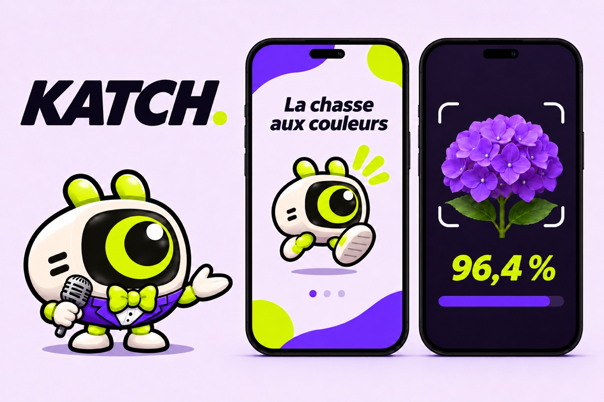

<p align="center">
  
</p>

<h1 align="center">Katch</h1>

<p align="center"><strong>La chasse aux couleurs du quotidien</strong></p>

<p align="center">
  Chaque jour, retrouve une couleur autour de toi, prends-la en photo et compare ton score à celui de tes amis.
</p>

<p align="center">
  
  
  
  
  
  
</p>

<p align="center">
  <a href="#fonctionnalités">Fonctionnalités</a> ·
  <a href="#installer-et-lancer-lapp">Installation</a> ·
  <a href="#démonstration-fonctionnelle">Démonstration</a> ·
  <a href="#limites-connues-et-axes-damélioration">Limites et suite</a> ·
  <a href="#décisions-darchitecture">ADR</a>
</p>



*Maquette de présentation du tutoriel et du résultat d’un défi photo.*

## Direction artistique

Dès la première ouverture, le tutoriel pose l’identité visuelle de Katch. La palette contrastée, les illustrations de Pix et les animations accompagnent la découverte du défi, du classement et des récompenses, jusqu’à une première chasse aux couleurs. On retrouve ensuite les mêmes codes dans le défi quotidien, notamment dans la transition façon BD et les retours haptiques de l’analyse photo. On s’est inspirés de Duolingo pour la place donnée à la mascotte et à ses réactions dans l’interface, avec un univers visuel propre à Katch. [La création des personnages de Duolingo](https://blog.duolingo.com/building-character/)

Pix accueille le joueur, prend la parole pendant la préparation de la photo et réagit au résultat. Sa présence du tutoriel jusqu’au verdict en fait un repère visuel que le joueur peut associer à Katch, même sans voir le nom de l’app. [Jenni Romaniuk sur les éléments distinctifs](https://ebims.emdev.au/brands-of-distinction/)

Le classement entre amis s’appuie sur la comparaison sociale. Comme les joueurs partagent le même défi du jour, chacun peut situer son score par rapport à celui de personnes qu’il connaît. [Leon Festinger sur la comparaison sociale](https://doi.org/10.1177/001872675400700202)

## Fonctionnalités

- **Défi du jour** — Une couleur commune à tous les joueurs, renouvelée à minuit UTC. Prends ou importe une photo, suis le balayage et découvre ton score à une décimale.
- **Amis et classements** — Envoie des demandes d’amitié et compare tes résultats dans le classement du jour, mondial ou entre amis.
- **Historique et collection** — Retrouve tes défis dans un calendrier, consulte tes photos dans la galerie et collectionne les couleurs validées.
- **Progression et récompenses** — Suis ta série, réclame tes badges et dépense tes KatchCoins dans la boutique pour personnaliser ton profil.

## Prérequis

- [Git](https://git-scm.com/).
- [Node.js](https://nodejs.org/) en version 24 LTS, à partir de 24.3.
- [pnpm](https://pnpm.io/installation).
- Un téléphone avec une version d’[Expo Go](https://expo.dev/go) compatible avec le SDK 58, ou un environnement de développement natif pour iOS ou Android.
- Accès au projet Supabase de l’équipe ou, pour travailler en local, un moteur Docker en cours d’exécution.

## Installer et lancer l’app

Depuis un terminal, clone le dépôt et installe les dépendances à la racine du monorepo.

```bash
git clone https://github.com/TheNathP/katch.git
cd katch
pnpm install --frozen-lockfile
cp apps/mobile/.env.example apps/mobile/.env.local
```

Utilise le projet Supabase de l’équipe ou une instance locale avec les migrations et les Edge Functions correspondant à la version du dépôt. Les fonctions `submit-photo` et `get-daily-color` fournissent le score à une décimale.

Dans `apps/mobile/.env.local`, vérifie que `EXPO_PUBLIC_SUPABASE_URL` correspond à ton projet Supabase, puis renseigne `EXPO_PUBLIC_SUPABASE_PUBLISHABLE_KEY`. Récupère l’URL et la clé publique dans **Connect** ou **Project Settings → API Keys** dans le tableau de bord Supabase. Le fichier `.env.local` est ignoré par Git. Réserve les clés secrètes et `service_role` au serveur. [Documentation des clés Supabase](https://supabase.com/docs/guides/getting-started/api-keys)

```bash
pnpm mobile --go
```

Connecte ton téléphone et ton ordinateur au même réseau, puis scanne le QR code affiché dans le terminal. Crée un compte de test sur le backend configuré ou connecte-toi avec un compte existant. Pour tester la prise de photo, utilise un téléphone physique.

Si le QR code ne permet pas de joindre Metro sur le réseau local, essaie `pnpm mobile --go --tunnel`. Le tunnel Expo donne accès à Metro. Un backend Supabase local doit toujours être joignable séparément depuis le téléphone. [Configuration d’Expo](https://docs.expo.dev/get-started/set-up-your-environment/)

## Limites connues et axes d’amélioration

### Passer à un build de développement

Le rendu reste accessible dans Expo Go. Pour la suite du projet, l’équipe passera à un **development build** propre à Katch afin de tester la caméra et les connexions Google et Apple dans le binaire de l’application. [Documentation Expo sur les development builds](https://docs.expo.dev/develop/development-builds/introduction/)

- **Caméra Android** — Une bande noire peut apparaître dans l’aperçu lors d’une reprise de photo avec Expo Go. Le correctif natif d’`expo-camera` est dans le dépôt et s’applique lorsqu’on compile Katch. L’import depuis la galerie permet de poursuivre la démo dans Expo Go si l’aperçu pose problème.
- **Connexion Google et Apple** — Le rendu utilise la connexion par e-mail et mot de passe. Le development build permettra de configurer et de vérifier les redirections OAuth, les identifiants de Katch et les capacités natives nécessaires à ces connexions. [Authentification avec Expo](https://docs.expo.dev/guides/authentication/)

### Installer le build Android avec le correctif caméra

Le dépôt contient un patch natif de la caméra Android. Pour tester ce correctif, compile l’application avec [l’environnement Android](https://docs.expo.dev/get-started/set-up-your-environment/) installé.

```bash
pnpm --filter @katch/mobile exec expo run:android
```

`expo run:android` génère et installe un APK de développement sur un appareil connecté ou un émulateur. Utilise un téléphone Android pour vérifier la reprise d’une photo. Sur macOS avec Xcode, la commande équivalente pour compiler l’app iOS est `pnpm --filter @katch/mobile exec expo run:ios`.

### Autres pistes

- **Accessibilité** — Tester les parcours avec VoiceOver et TalkBack, avec du texte agrandi et différents niveaux de contraste. Affiner les annonces et la navigation au lecteur d’écran.
- **Mise en cache** — Étendre la mise en cache aux listes souvent consultées et définir leur durée de fraîcheur, leur invalidation après modification et leur affichage hors connexion.
- **Analytics** — Mesurer la compréhension de l’onboarding et les étapes où les joueurs abandonnent le défi, avec des événements minimaux qui excluent les photos et les données nominatives.
- **CI/CD** — Automatiser le lint, le contrôle TypeScript et les tests sur chaque PR, puis préparer des builds de prévisualisation et fiabiliser le déploiement des migrations et des Edge Functions.

## Utiliser Supabase en local

Démarre Docker, puis lance Supabase depuis la racine. Le CLI est fourni par le workspace backend.

```bash
pnpm --filter @katch/backend exec supabase start
pnpm --filter @katch/backend exec supabase status
```

Dans `apps/mobile/.env.local`, utilise l’URL de l’API locale indiquée par `status` et sa clé `Publishable` (ou `anon` pour les anciennes clés locales). Sur un téléphone physique, remplace `127.0.0.1` dans l’URL par l’adresse IP locale de ton ordinateur. Sur l’émulateur Android standard, utilise `10.0.2.2`. Le port API par défaut de Katch est `55321`.

Pour servir les Edge Functions avec rechargement pendant le développement, lance dans un terminal dédié :

```bash
pnpm --filter @katch/backend exec supabase functions serve
```

Relance Metro après avoir modifié les variables d’environnement. Pour arrêter les services locaux, utilise `pnpm --filter @katch/backend exec supabase stop`. [Documentation Supabase CLI](https://supabase.com/docs/guides/local-development/cli/getting-started)

## Démonstration fonctionnelle

1. Connecte-toi avec un compte de test et révèle la couleur du jour.
2. Prends ou importe une photo, confirme-la et observe le balayage, le verdict et le score.
3. Reviens à l’accueil pour voir le score du jour, puis ouvre le classement mondial ou entre amis.
4. Ouvre ton profil pour retrouver l’historique, la galerie et la collection de couleurs.
5. Consulte ta progression et réclame un badge si le compte de test en a un d’éligible.

## Vérifications

Depuis la racine du dépôt, lance les vérifications mobiles et backend. Les tests mobiles couvrent le cache du défi, le rafraîchissement du profil après une participation, les liens signés et les erreurs d’aperçu photo. La suite backend utilise des bases de test isolées.

```bash
pnpm lint
pnpm typecheck
pnpm test
```

Utilise `pnpm --filter @katch/mobile test` pour lancer uniquement la suite mobile.

### Parcours Maestro

Utilise un simulateur iOS ou un émulateur Android dédié avec un build de Katch installé et configuré pour un backend de test accessible depuis l’appareil. Les scénarios réinitialisent les données locales du build avant de se connecter.

Avec [Maestro CLI](https://docs.maestro.dev/maestro-cli/how-to-install-maestro-cli), définis `APP_ID` avec le bundle ID iOS ou le nom du package Android du build. Exporte `MAESTRO_TEST_EMAIL` et `MAESTRO_TEST_PASSWORD` pour un compte confirmé sur ce backend. Lance les scénarios depuis la racine du dépôt, hors du changement de jour à minuit UTC.

- `daily-color-persists.yaml` vérifie que la couleur dévoilée reste visible après redémarrage. Lance-le avec un compte qui n’a encore envoyé aucune photo pour le défi du jour.
- `photo-retake-history.yaml` ajoute un JPEG de test à la galerie, l’importe deux fois après « Refaire », puis vérifie le score et la photo dans l’historique. Utilise un appareil de test réglé en anglais avec une galerie vide ou réservée à cette image. Le scénario enregistre une participation sur le backend de test.

```bash
maestro test -e APP_ID="$APP_ID" .maestro/daily-color-persists.yaml
maestro test -e APP_ID="$APP_ID" .maestro/photo-retake-history.yaml
```

## Structure du dépôt

- [`apps/mobile`](apps/mobile) héberge l’app Expo et React Native.
- [`apps/backend/supabase`](apps/backend/supabase) contient les migrations SQL et les Edge Functions.
- [`docs/adr`](docs/adr) documente les décisions d’architecture.

### Réutiliser les composants mobiles

Les composants communs vivent dans `apps/mobile/src/components/ui`. Les composants propres à un écran vivent dans son dossier `_page`. L’écran garde la navigation, les données et les actions métier.

- `Screen` fournit le fond et les marges de zone sûre. Utilise `scroll={false}` si l’écran contient déjà une `FlatList`.
- `Button` propose les variantes `primarySolid`, `limeSolid`, `outline` et `ghost`. Sur `ghost`, `tone="danger"` signale une action destructive et `tone="muted"` convient à une action secondaire. `busy` désactive l’action et indique son état aux lecteurs d’écran.
- `Dialog` se configure avec `placement` et `onClose`. `SegmentedTabs` reçoit `options`, `value` et `onChange` pour les changements de vue.
- `Skeleton` annonce le chargement d’une section. Les `SkeletonBlock` reprennent les dimensions du contenu attendu.

## Décisions d’architecture

| ADR | Décision |
| --- | --- |
| [001](docs/adr/001-react-native-expo.md) | Partager le code mobile iOS et Android avec React Native et Expo. |
| [002](docs/adr/002-supabase.md) | Utiliser Supabase pour le backend. |
| [003](docs/adr/003-expo-router-navigation.md) | Organiser la navigation avec Expo Router. |
| [004](docs/adr/004-authentication.md) | Utiliser l’authentification e-mail avec une session chiffrée. |
| [005](docs/adr/005-daily-challenge-color.md) | Partager le défi du jour selon le calendrier UTC. |
| [006](docs/adr/006-expo-push-delivery.md) | Mettre les notifications push en file d’attente côté serveur. |
| [007](docs/adr/007-expo-go-delivery.md) | Garder Expo Go pour le rendu et reporter les intégrations qui exigent une build dédiée. |
| [008](docs/adr/008-server-side-photo-scoring.md) | Calculer le score photo côté serveur et animer sa restitution côté mobile. |
| [009](docs/adr/009-history-and-collection.md) | Construire l’historique, la galerie et la collection à partir des résultats personnels. |
| [010](docs/adr/010-server-side-rewards.md) | Calculer la progression et gérer les KatchCoins côté serveur. |
| [011](docs/adr/011-local-cache-and-refresh.md) | Afficher le dernier état disponible et resynchroniser les données en arrière-plan. |
| [012](docs/adr/012-social-and-photo-visibility.md) | Séparer la visibilité des scores et des photos dans les classements. |
